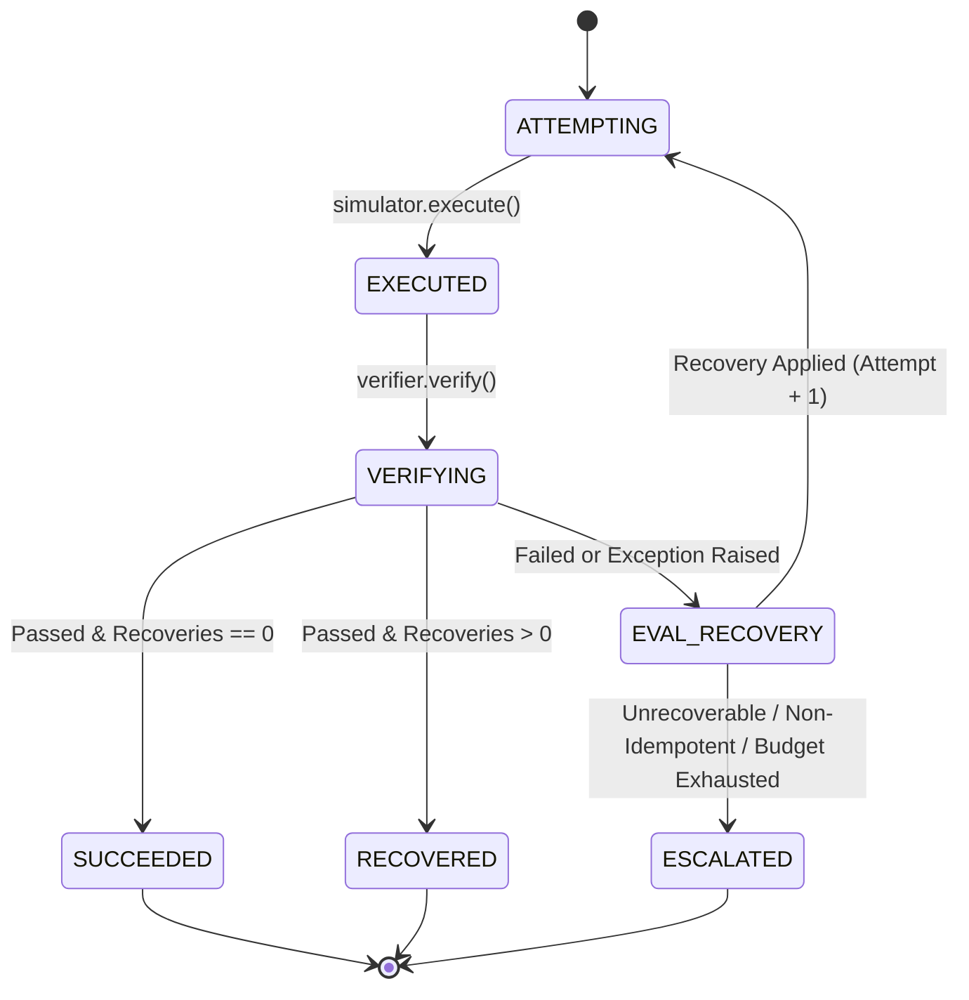
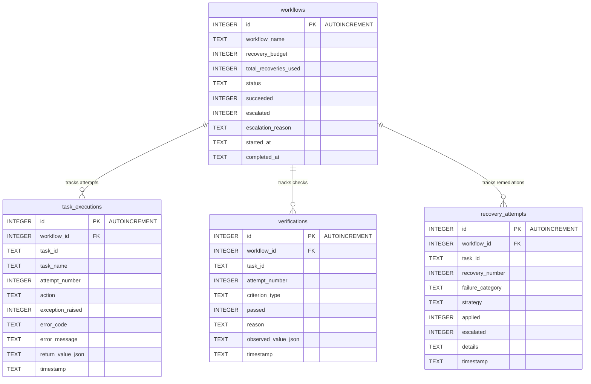

# RecoverOps AI Architecture Specification

This document details the architectural structure, component responsibilities, state transition rules, and database schema for the RecoverOps AI core engine.

---

## 1. System Components & Responsibilities

```
                                  +-------------------+
                                  |    app/main.py    |
                                  +---------+---------+
                                            |
                                            v
                                +-----------------------+
                                |  app/workflow.py      |
                                |  (WorkflowExecutor)   |
                                +-----+-----+-----+-----+
                                      |     |     |     |
              +-----------------------+     |     |     +-----------------------+
              |                             |     |                             |
              v                             v     v                             v
  +-----------------------+      +-------------+  +---------------+  +-------------------+
  | app/failure_simulator |      | app/        |  | app/          |  | app/storage.py    |
  | (FailureSimulator)    |      | verification|  | recovery.py   |  | (Storage)         |
  | - Path sandbox jail   |      | (Verifier)  |  | (RecoveryMgr) |  | - Parameterized   |
  | - Fault injection     |      | - Independent| | - Guardrails  |  |   SQLite audit    |
  +-----------------------+      +-------------+  +---------------+  +-------------------+
              |                             |             |                     |
              +-----------------------------+-------------+---------------------+
                                            |
                                            v
                                  +-------------------+
                                  |   app/models.py   |
                                  |  (Contracts/Enums)|
                                  +-------------------+
```

### Component Breakdown
1. **`app/models.py`**:
   Pure data definitions, immutable dataclasses, enums, and validation contracts. Imports zero internal application modules.
2. **`app/failure_simulator.py`**:
   Encapsulates task execution and fault injection inside an isolated filesystem sandbox. Jails path resolution via `resolve_safe_path()`.
3. **`app/verification.py`**:
   Decoupled engine that independently inspects task execution outcomes against declarative success criteria (`SuccessCriteria`).
4. **`app/recovery.py`**:
   Classifies failures and applies guardrail evaluation in strict priority order before dispatching remediation strategies.
5. **`app/storage.py`**:
   Relational SQLite persistence store providing transactional audit trails for all workflow, execution, verification, and recovery events.
6. **`app/workflow.py`**:
   Central orchestrator implementing the execution loop, budget accounting, and lifecycle state management.
7. **`app/main.py`**:
   CLI entrypoint executing sample self-healing demonstration pipelines.

---

## 2. State Transitions & Lifecycle Rules

### Task State Machine



### Workflow State Transitions
- **`COMPLETED`**: All tasks reached `SUCCEEDED` status with 0 recoveries used.
- **`COMPLETED_WITH_RECOVERY`**: All tasks reached either `SUCCEEDED` or `RECOVERED` status with $\ge 1$ automated recovery applied.
- **`ESCALATED`**: Any task reached `ESCALATED` status. Execution halted immediately; all remaining downstream tasks are skipped.
- **`FAILED`**: Terminal failure state (if unhandled system error occurs).

---

## 3. Recovery Guardrail Precedence & Budget Ownership

### Guardrail Pipeline Hierarchy
When a task attempt fails verification or raises an execution exception, `RecoveryManager.attempt_recovery` evaluates guardrails in strict order:

```
[Failure Detected]
        |
        v
[1. Unrecoverable Error?] -----------> YES ---> ESCALATE (Human required)
        | NO
        v
[2. Task Non-Idempotent?] -----------> YES ---> ESCALATE (Unsafe to retry)
        | NO
        v
[3. Attempt >= max_attempts?] -------> YES ---> ESCALATE (Attempts exhausted)
        | NO
        v
[4. Recoveries >= max_recoveries?] --> YES ---> ESCALATE (Task budget exhausted)
        | NO
        v
[5. Shared Recoveries >= Budget?] ---> YES ---> ESCALATE (Workflow budget exhausted)
        | NO
        v
[6. Select Strategy] ---------------> RETRY | RESET_SERVICE | RESTORE_FILE | SANITIZE
```

### Invariant: Budget Ownership
`RecoveryManager` only **inspects** budget counters; it never mutates them. `WorkflowExecutor` is the **single owner** that increments per-task and shared recovery counters, and only after a recovery strategy is confirmed applied and unescalated.

---

## 4. Controlled Exception Boundary

To prevent unhandled runtime errors from crashing the orchestrator, `WorkflowExecutor` implements a strict exception boundary around the execution of each task:

```python
try:
    execution = self.simulator.execute(task, attempt)
except Exception as exc:
    execution = ExecutionResult(
        task_id=task.id,
        attempt_number=attempt,
        action=task.action,
        return_value=None,
        exception_raised=True,
        error_code=FailureCategory.UNRECOVERABLE_ERROR,
        error_message=f"Unhandled exception during task execution: {exc}",
    )
```

No broad `except Exception` blocks exist in helpers or library utilities; exceptions are cleanly transformed into structured, auditable domain failure objects at the executor boundary.

---

## 5. Relational SQLite Audit Schema



---

## 6. Documented Extension Points (Future Architecture)

The following architectural extension points are designed into the contracts for Phase 2 implementation:
1. **Pluggable Task Runners**:
   Replace `FailureSimulator.execute` with external worker adapters (e.g., containerized execution, isolated gRPC workers) while maintaining the `Task -> ExecutionResult` contract.
2. **Policy Hooks**:
   Injectable callbacks before and after recovery decisions for enterprise compliance auditing and rate limiting.
3. **Read-Only Observability UI**:
   A zero-overhead HTTP/WebSocket streaming interface consuming SQLite audit tables for real-time dashboard telemetry.
4. **Human-in-the-Loop Approval Callbacks**:
   When an escalation is triggered, an asynchronous webhook callback can await explicit human authorization before resuming the workflow.

