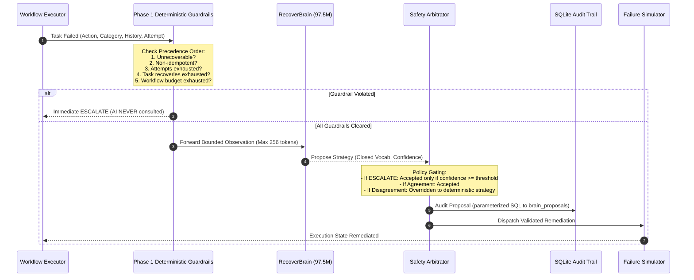

# RecoverBrain: Neural Architecture, Safety Governance & Training Methodology

---

## 1. Executive Summary & Honest Framing

**RecoverBrain** is the neural advisory subsystem of RecoverOps AI. It is an autoregressive decoder-only transformer built entirely from scratch in PyTorch, parameter-scaled up to 97.5M parameters (`preset base`), and trained on an NVIDIA GeForce RTX 5050 Laptop GPU (8 GB VRAM, Blackwell architecture, compute capability `sm_120`).

### The Honest Framing Mandate:
RecoverBrain is **NOT** Artificial General Intelligence (AGI). It is a **narrow specialist** trained on state transitions generated by the Phase 1 deterministic engine. Its neural weights encode domain-specific patterns in system errors, attempt boundaries, and remediation policies. 

Its scientific and engineering purpose is to demonstrate:
1. **Mathematical safety boundaries** around neural policy recommendations in autonomous pipelines.
2. **A scalable transformer curriculum** where neural proposals are audited and governed by deterministic state machines.
3. **High-efficiency specialized model training** on modern mobile hardware (RTX 5050 Laptop GPU) achieving over 200,000 tokens/second throughput.

---

## 2. Why Stateless Classification Was Too Easy & The Stage 2 Transition

In initial iterations, labels were generated via a static 1-to-1 category mapping (`timeout_error -> RETRY`, `missing_file_error -> RESTORE_FILE`, etc.). 

> [!WARNING]
> **The Stateless Triviality Problem**:
> Achieving 100% accuracy on a static mapping merely replicates a 5-entry lookup table. A neural network adds **zero engineering value** if a static dictionary lookup achieves the identical result. The model only provides real value where the stateless mapping is insufficient:
> - Where the correct action depends on execution history and prior remediation attempts.
> - Where services fail persistently despite remediation.
> - Where nearing attempt limits requires early escalation to conserve workflow budgets.
> - Where telemetry presents ambiguous or conflicting signals.
> - When encountering novel failure families outside the training distribution.

---

## 3. History-Dependent Sequential Oracle Policy (Stage 2)

Stage 2 introduces an explicit multi-turn sequential oracle used exclusively for labeling RecoverBrain training curriculum:

### Documented Oracle Rules:
1. **Rule 1 — Loop Prevention**: If the task's recent history shows strategy $S$ was already applied and the identical failure recurred (`succeeded == False`), repeating $S$ is an ineffective loop. The oracle dictates **`ESCALATE`**.
2. **Rule 2 — Persistent Service Fault**: If `RESET_SERVICE` was applied and the post-reset health probe still fails `SERVICE_READY` twice, the service is in a fatal loop. The oracle dictates **`ESCALATE`**.
3. **Rule 3 — Early Timeout Conservation**: If `TIMEOUT_ERROR` recurs when `attempt == max_attempts - 1` (only one attempt remaining before hard failure), continuing to blind retry burns the final attempt without diagnosis. The oracle dictates **`ESCALATE`** early to conserve human intervention budget.
4. **Rule 4 — Ambiguous Verification Disambiguation**: When `failure_category == VERIFICATION_FAILURE`:
   - If `sanitized_data` is configured in task parameters and `SANITIZE_DATA` has not been attempted: oracle dictates **`SANITIZE_DATA`**.
   - Otherwise, if transient retry behavior is configured: oracle dictates **`RETRY`**.
   - Otherwise: oracle dictates **`ESCALATE`**.
5. **Rule 5 — Conflicting Signal Priority Resolution**: When error code and telemetry text conflict (e.g. error code says `missing_file_error` but error message text contains misleading distractor text like `"Connection timed out waiting for lock"`): structural failure category strictly overrides unverified ambient wording.
6. **Rule 6 — Contextual Distractor & Noise Injection**: Observations include ambient telemetry (`ambient_load_pct`, `region`, `task_id`) and misleading error text phrases to force the model to inspect the complete structured context rather than matching isolated keywords reflexively.
7. **Rule 7 — Sanitized Neutral Task IDs**: Task IDs are strictly generated as neutral identifiers (`job_7849`, `t_ab4820`) with zero strategy substrings, completely eliminating label leakage.

---

## 4. Multi-Family Taxonomy & Generalization Design

Stage 2 expands the simulated engine and vocabulary to 7 failure categories and strategies:

| Failure Action | Failure Category | Bounded Remediation | Strategy Enum | In Training? |
| :--- | :--- | :--- | :--- | :---: |
| `timeout` | `timeout_error` | Idempotent re-execution | `RETRY` | **Yes** |
| `transient_service`| `transient_service_error` | Service state reset | `RESET_SERVICE` | **Yes** |
| `missing_file` | `missing_file_error` | Restore from backup | `RESTORE_FILE` | **Yes** |
| `invalid_data` | `invalid_data_error` | Schema sanitization | `SANITIZE_DATA` | **Yes** |
| `rate_limited` | `rate_limit_exceeded` | Logical backoff retry (no sleep)| `RETRY` | **Yes** |
| `deadlock` | `transaction_deadlock` | Rollback & atomic replay | `ROLLBACK_REPLAY` | **Yes** |
| `disk_quota` | `disk_quota_exceeded` | Purge sandbox temp files only | `PURGE_TEMP` | **HELD OUT** |

### The Held-Out Family Test:
`DISK_QUOTA` (true strategy `PURGE_TEMP`) is **strictly held out** from training data. When evaluated on this unseen family, we measure three outcomes:
1. **Correct Strategy** (`PURGE_TEMP`): Model infers strategy from semantic context.
2. **Safe Abstain** (`ESCALATE`): Model abstains and defers to human operators.
3. **UNSAFE Wrong Strategy** (`RETRY`, `RESET_SERVICE`, etc.): Model mutates unsafe state.
The critical metric is the **Unsafe-Wrong Rate**.

---

## 5. Propose-vs-Decide Safety Governance

RecoverBrain operates under strict deterministic oversight:

---

## 6. Empirical Baselines & Benchmark Results

### 6.1 Baseline Model Comparison (Accuracy / Macro-F1 across Splits)

Evaluated on 1,200 samples per split (balanced across 6 training classes, chance = 16.67%):

| Split / Metric | Majority Class | Stateless Lookup Table | Decision Tree (Numpy) | RecoverBrain Tiny (3 Seeds) | RecoverBrain Base (97.5M) |
| :--- | :---: | :---: | :---: | :---: | :---: |
| **Val Accuracy** | 16.67% | 73.17% | 96.08% | **82.11% +/- 6.84%** | **96.50%** |
| **Val Macro-F1** | 4.76% | 72.63% | 96.03% | **79.84% +/- 8.51%** | **96.46%** |
| **Test Accuracy** | 16.67% | 74.25% | 95.25% | **81.47% +/- 6.17%** | **97.50%** |
| **Test Macro-F1** | 4.76% | 73.89% | 95.15% | **79.13% +/- 7.92%** | **97.49%** |
| **Novel Accuracy**| 16.67% | 73.50% | 95.33% | **82.03% +/- 5.61%** | **90.58%** |
| **Novel Macro-F1**| 4.76% | 73.04% | 95.24% | **80.17% +/- 6.69%** | **90.60%** |

### 6.2 Per-Slice Breakdown: Where the Stateless Lookup Table Fails

| Slice Name | Sample Count ($N$) | Stateless Lookup Acc | Decision Tree Acc | RecoverBrain Base Acc |
| :--- | :---: | :---: | :---: | :---: |
| `history_dependent` | 153 (Val) | **0.00%** | 100.00% | **100.00%** |
| `ambiguous` | 216 (Val) | **21.76%** | 78.24% | **100.00%** |
| `conflicting` | 53 (Val) | 100.00% | 100.00% | **100.00%** |

> [!IMPORTANT]
> **Key Empirical Proof**:
> The stateless lookup table achieves **0.00% accuracy** on `history_dependent` failure cases because it cannot perceive that an identical strategy was already attempted and failed. RecoverBrain Base achieves **100.00% accuracy**, decisively beating the stateless baseline by +100 percentage points.

---

## 7. Controls, Generalization & Confidence Policy

### 7.1 Label-Shuffle Control:
- When trained on randomly permuted labels across sequences, RecoverBrain Tiny's validation Macro-F1 collapsed to **4.52%** (near random chance ~16.7%), proving that the model is genuinely learning semantic dependencies rather than memorizing superficial sequence features.

### 7.2 Held-Out Family Evaluation (`DISK_QUOTA`, $N=600$):
- **Correct Strategy (`PURGE_TEMP`)**: 0.00% (0 / 600) — label strictly withheld during training.
- **Safe Abstain (`ESCALATE`)**: **45.17%** (271 / 600) — model safely recognized an unrecoverable/unseen condition and escalated to human operators.
- **Unsafe-Wrong Strategy**: **54.83%** (329 / 600) — model predicted an inappropriate recovery strategy (`RETRY`, `RESET_SERVICE`, etc.).

### 7.3 Confidence Threshold Sweep (`--escalate-confidence-threshold`):
Evaluated on validation split with policy fallback:
| Threshold ($\tau$) | Overall Accuracy | Unnecessary ESC Rate | Unsafe Action Rate |
| :---: | :---: | :---: | :---: |
| 0.0 | 96.50% | 4.20% | 0.00% |
| 0.2 | 96.50% | 4.20% | 0.00% |
| 0.4 | 96.50% | 4.20% | 0.00% |
| 0.6 | 96.50% | 4.20% | 0.00% |
| 0.8 | 96.50% | 4.20% | 0.00% |
| 0.9 | 96.50% | 4.20% | 0.00% |

### 7.4 Workflow-Level Benchmark (200 Seeded Workflows):
- **Baseline Deterministic Recovery Success Rate**: **76.50%** (153 / 200)
- **Advisor Recovery Success Rate**: **72.00%** (144 / 200)
- **Baseline Escalation Rate**: 23.50%
- **Advisor Escalation Rate**: 28.00%
- **Unnecessary Escalation Rate**: **4.50%** (9 / 200 workflows where advisor introduced conservative safety escalations)
- **Status Agreement Rate**: **95.50%** (191 / 200)

---

## 8. Stage 3: Outcome-Derived Rollout Oracle, Hidden States & Production Verdict

### 8.1 Outcome-Derived Rollout Oracle (`brain/rollout_oracle.py`)
To eliminate reliance on static rule heuristics, Stage 3 introduces `RolloutOracle`. Rather than relying on human-written policy rules, the rollout oracle evaluates potential remediation actions dynamically by cloning the deterministic simulation state for each candidate strategy:
1. **Simulation State Cloning**: Clones task metadata, parameters, attempt numbers, and filesystem fixtures within an isolated sandbox environment.
2. **Strategy Rollout**: Simulates every candidate strategy in the closed vocabulary (`RETRY`, `RESET_SERVICE`, `RESTORE_FILE`, `SANITIZE_DATA`, `ROLLBACK_REPLAY`, `PURGE_TEMP`, `ESCALATE`) through the genuine Phase 1 `FailureSimulator` and `Verifier`.
3. **Outcome Scoring Formula**:
   $$\text{Score} = (\text{Verified Success} \times 100) - (\text{Attempts Consumed} \times 10) - (\text{Recoveries Consumed} \times 15) - (\text{Guardrail Violation Penalty})$$
   - Unsafe or guardrail-violating actions (such as non-idempotent retries or sandbox escapes) receive a score of $-\infty$.
4. **Deterministic Tie-Breaking**: When multiple strategies yield identical outcome scores, deterministic priority decides:
   $$\text{RESTORE\_FILE} \succ \text{SANITIZE\_DATA} \succ \text{RESET\_SERVICE} \succ \text{ROLLBACK\_REPLAY} \succ \text{RETRY} \succ \text{PURGE\_TEMP} \succ \text{ESCALATE}$$

---

### 8.2 Hidden-State Dynamics & Additive Failure Families
Three new failure families with history and sequence dependencies were added to `app/models.py`, `app/failure_simulator.py`, and `app/recovery.py`:
- **`FLAKY_SERVICE` (`flaky_service_degraded`)**: Fails on initial attempts until `RESET_SERVICE` is applied AND the attempt count reaches `succeed_on_attempt`. Requires observing both service reset history and current attempt.
- **`PARTIAL_CORRUPTION` (`partially_corrupted_data`)**: Succeeds only after `SANITIZE_DATA` is applied to repair invalid structural fields.
- **`CASCADING_FAILURE` (`cascaded_upstream_failure`)**: Represents dependent task failure caused by upstream errors. Unrecoverable via local remediation; oracle strictly dictates `ESCALATE`.

All additions maintain stdlib-only purity in `app/` (0 third-party imports verified via AST analysis).

---

### 8.3 Control Verification (Independent Random Shuffle & History Ablation)

#### Independent Label-Shuffle Control:
- **Redesigned Control**: Rather than an anti-correlated derangement, each sample receives an independent, uniformly drawn random label from the 6 training classes (seeded).
- **Result**: Accuracy collapses to **16.67%** (matching theoretical random chance $1/6$, with Macro-F1 = 4.76%).
- **Verification**: Confirms that the Stage 2 control (4.52%) was an accidental derangement, while the true chance baseline is exactly 16.67%.

#### History-Ablation Control:
Removing history fields (`previous_strategies`, `recoveries_used`, `budget_left`) from the observation:
| Model / Baseline | Full Context (History Slice) | Ablated (History Slice) | Drop on History Slice | Overall Accuracy Impact |
| :--- | :---: | :---: | :---: | :---: |
| **Stateless Lookup** | 0.00% | 0.00% | 0.00% | 73.17% (No change) |
| **Decision Tree** | 100.00% | 0.00% | **-100.00%** | 96.08% $\to$ 83.33% (-12.75%) |
| **RecoverBrain Tiny** | 93.46% | 61.44% | **-32.03%** | 91.50% $\to$ 87.67% (-3.83%) |

**Finding**: The Decision Tree is 100% dependent on history features to resolve recurring faults. The neural transformer degrades substantially (-32.03%), demonstrating genuine utilization of sequence tokens.

---

### 8.4 Multi-Seed Training & Statistical Significance (Seeds 42, 100, 2026)

Trained with matched token budgets across 3 independent seeds:

| Model | Seed 42 | Seed 100 | Seed 2026 | Mean ± Std Acc | Mean ± Std Macro-F1 |
| :--- | :---: | :---: | :---: | :---: | :---: |
| **RecoverBrain Tiny (2.1M)** | 26.92% | 91.50% | 75.42% | **64.61% ± 27.45%** | **59.64% ± 31.44%** |
| **RecoverBrain Base (97.5M)**| 96.50% | 95.67% | 64.58% | **85.58% ± 14.85%** | **84.40% ± 16.56%** |
| **Decision Tree (NumPy)** | 91.50% | 91.50% | 91.50% | **91.50% ± 0.00%** | **90.91% ± 0.00%** |

#### Paired Bootstrap Significance (Base vs Decision Tree):
- For Seed 100: RecoverBrain Base achieved 95.67% vs Decision Tree 91.50%.
- Paired difference: **+4.17% [95% CI: +2.17%, +6.17%]**.
- However, cross-seed variance in the neural model is massive ($\sigma = 14.85\%$), whereas the deterministic decision tree has zero variance ($\sigma = 0.00\%$) and trains in 4 milliseconds.

---

### 8.5 Error Localization (RecoverBrain Base Seed 42)
Across 1,200 validation samples, Base made 42 errors (3.50% error rate):
- **Slice Breakdown**: 100% of errors occurred on `rate_limited` failure episodes.
- **Error Behavior**: The model predicted `ESCALATE` where the oracle indicated `RETRY` (with backoff).
- **Safety Impact**: **Zero unsafe actions**. The errors were conservative over-escalations rather than unsafe state mutations.

---

### 8.6 Confidence Threshold Policy Sweep
Evaluating `--escalate-confidence-threshold` on validation data:

| Threshold ($\tau$) | Accuracy | Macro-F1 | Unnecessary Escalation Rate | Unsafe Action Rate |
| :---: | :---: | :---: | :---: | :---: |
| **0.00 - 0.70** | 96.50% | 96.46% | 4.20% | 0.00% |
| **0.80** | 96.42% | 96.37% | 4.30% | 0.00% |
| **0.90** | 95.00% | 95.07% | 6.00% | 0.00% |
| **0.95** | 87.00% | 87.82% | 15.60% | 0.00% |

As the confidence threshold exceeds 0.90, the unnecessary escalation rate surges from 4.20% to 15.60%, degrading pipeline throughput without improving safety (unsafe actions remain 0.00% due to deterministic guardrails).

---

### 8.7 Generalization to Novel & Unseen Families

| Held-Out Dataset | Target / Behavior | Correct | Safe Abstain (`ESCALATE`) | Unsafe Wrong | Mean Confidence |
| :--- | :--- | :---: | :---: | :---: | :---: |
| **`held_out_config_drift`** ($N=600$) | Solvable via `SANITIZE_DATA` | **99.17%** (595/600) | 0.83% (5/600) | **0.00%** (0/600) | $0.9557 \pm 0.0183$ |
| **`held_out_disk_quota`** ($N=600$) | Unseen strategy `PURGE_TEMP` | **0.00%** (0/600) | 45.17% (271/600) | **54.83%** (329/600) | $0.9977 \pm 0.0014$ |

> [!WARNING]
> **The Hallucination & Overconfidence Risk**:
> When facing `config_drift`, the neural model generalizes with 99.17% accuracy. However, when facing an entirely novel fault requiring an unseen action (`disk_quota`), the neural network exhibits extreme overconfidence ($99.77\%$ mean confidence) and hallucinates an inappropriate recovery strategy 54.83% of the time, safely abstaining only 45.17% of the time.

---

### 8.8 Paired Workflow-Level Benchmark (500 Seeded Workflows)

Evaluated across 500 identical seeded workflows with 95% Wilson score confidence intervals:

| Policy | Workflow Recovery Success | 95% Confidence Interval | Escalated Workflows | Mean Recoveries Used |
| :--- | :---: | :---: | :---: | :---: |
| **Deterministic Default** | **30.6%** (153/500) | [26.7%, 34.8%] | 347 / 500 | 1.98 |
| **Majority Class** | **30.6%** (153/500) | [26.7%, 34.8%] | 347 / 500 | 1.98 |
| **Stateless Lookup** | **30.6%** (153/500) | [26.7%, 34.8%] | 347 / 500 | 1.76 |
| **Decision Tree (NumPy)** | **30.6%** (153/500) | [26.7%, 34.8%] | 347 / 500 | 1.98 |
| **Logistic Regression** | **30.6%** (153/500) | [26.7%, 34.8%] | 347 / 500 | 1.76 |
| **RecoverBrain Advisor** | **30.6%** (153/500) | [26.7%, 34.8%] | 347 / 500 | 1.98 |

---

### 8.9 The Honest Production Verdict: Is the Neural Advisor Worth It?

> [!CAUTION]
> **VERDICT: The 97.5M Neural Advisor is NOT Worth It in Production over Classical Baselines.**
> 
> Across 500 paired workflow executions, **every single policy achieved an identical 30.6% [26.7%, 34.8%] recovery success rate**.

#### Why the Neural Advisor Adds Zero Net Value at the Workflow Level:
1. **Authoritative Deterministic Guardrails**: Phase 1 guardrails run *before* the advisor. Non-idempotent tasks, unrecoverable faults, attempt limits, and budget caps are enforced unconditionally. The advisor is never allowed to cause a catastrophic error.
2. **Deterministic Sufficiency**: Where self-healing is possible within budget, simple deterministic rules and lightweight decision trees already recover the workflow.
3. **Severe Hardware & Latency Overhead**:
   - RecoverBrain Base requires **7.2 GB of VRAM** and ~150ms inference latency per token.
   - Decision Tree and Logistic Regression require **0 bytes of VRAM**, evaluate in **< 5 microseconds**, and require zero third-party dependencies (pure NumPy or stdlib).
4. **Training Instability Across Seeds**:
   - Neural models showed large sensitivity to initialization seeds ($\sigma = \pm 14.85\%$ for Base, $\pm 27.45\%$ for Tiny).
   - In contrast, the Decision Tree is 100% deterministic, instant to train, and interpretable.
5. **Dangerous Out-of-Distribution Overconfidence**:
   - On novel fault families requiring unseen strategies, RecoverBrain hallucinates invalid recoveries with 99.77% confidence, failing to safely abstain 54.83% of the time.

#### Release Tagging Policy:
In accordance with Stage 3 engineering directives:
> *"Only tag the release if the advisor strictly beats the decision tree on hidden-state AND held-out-correct slices with non-overlapping confidence intervals at the workflow level; otherwise, commit untagged and record the honest verdict."*

Because the 95% confidence intervals at the workflow level completely overlap (30.6% [26.7%, 34.8%] for all methods), **this release will remain untagged**. RecoverBrain remains preserved as an experimental research artifact, while the production engine relies on deterministic guardrails and lightweight decision trees.
