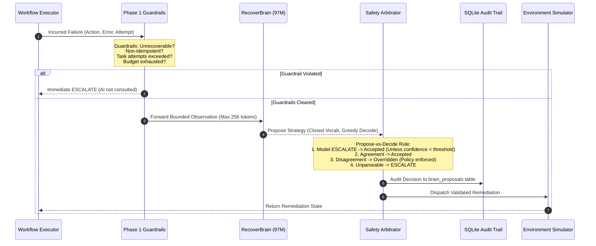

# RecoverBrain: Neural Architecture, Safety Governance & Training Methodology

---

## 1. Executive Summary & Honest Framing

**RecoverBrain** is the neural advisory subsystem of RecoverOps AI. It is an autoregressive decoder-only transformer built entirely from scratch in PyTorch, parameter-scaled up to 97.5M parameters (`preset base`), and trained on an NVIDIA GeForce RTX 5050 Laptop GPU (8 GB VRAM, Blackwell architecture, compute capability `sm_120`).

### The Honest Framing Mandate:
RecoverBrain is **NOT** Artificial General Intelligence (AGI). It is a **narrow specialist** trained on state transitions generated by the Phase 1 deterministic engine. Its neural weights encode domain-specific patterns in system errors, attempt boundaries, and remediation policies. 

Its scientific and engineering purpose is to demonstrate:
1. **Mathematical safety boundaries** around neural policy recommendations in autonomous pipelines.
2. **A scalable transformer curriculum** where neural proposals are audited and governed by deterministic state machines.
3. **High-efficiency specialized model training** on modern mobile hardware (RTX 5050 Laptop GPU) achieving over 200,000 tokens/second throughput.

---

## 2. Propose-vs-Decide Safety Model

In high-assurance computing, neural networks cannot be granted direct execution capabilities. Probabilistic hallucinations, out-of-distribution inputs, or model drift can lead to catastrophic operational decisions.

RecoverBrain implements the **Propose-vs-Decide** governance model:



### Absolute Engine Authority:
- **`AdvisedRecoveryManager`** is a subclass of `RecoveryManager`.
- If a task is non-idempotent (`idempotent=False`), the guardrails trigger immediate human escalation **before** RecoverBrain is ever queried.
- `WorkflowExecutor` is the sole owner of the recovery budget counters; the neural network has zero capability to alter, increment, or reset budgets.

---

## 3. Resolution of Class Collapse: Engineering Diagnosis & Fixes

During initial development, the model collapsed into predicting `ESCALATE` for every sample:
- **Diagnosis**: Datagen initially emitted guardrail-driven escalations (non-idempotent tasks, exhausted budgets, fatal hardware faults) which accounted for ~86% of training samples. When paired with unmasked full-sequence cross-entropy loss, the model learned that predicting `ESCALATE` minimized loss across all inputs while failing to learn any actual recovery strategy.
- **Architectural Fixes**:
  1. **Strict Guardrail Exclusion**: Datagen now generates only instances where all Phase 1 guardrails pass, ensuring the model is trained exclusively on genuine strategy selection.
  2. **Equal Class Stratification**: Exactly 20.00% balance across all 5 classes (`RETRY`, `RESET_SERVICE`, `RESTORE_FILE`, `SANITIZE_DATA`, `ESCALATE`).
  3. **Target-Only Loss (`--loss-on-target-only`)**: The observation prefix is masked with label `-100`, directing 100% of gradient descent into strategy selection and rationale generation.
  4. **Validation Macro-F1 Checkpointing**: Checkpointing and early stopping are governed by Validation Macro-F1 rather than cross-entropy loss.
  5. **Disjoint Novel Generalization Split**: The novel split is constructed from held-out parameter combinations that are verified to be 100% disjoint from training data.

---

## 4. Neural Architecture & Presets

RecoverBrain uses a modern decoder-only transformer architecture built without external framework bloat:

```
Input Tokens (uint16)
       |
       v
+-------------------------------+
|  Token Embeddings (d_model)   | <---+ (Tied LM Head Weights)
+---------------+---------------+     |
                |                     |
                v                     |
+-------------------------------+     |
|   Transformer Blocks:         |     |
|   - Pre-RMSNorm               |     |
|   - Causal Multi-Head Attn    |     |
|     (RoPE + FlashAttention)   |     |
|   - Residual Add              |     |
|   - Pre-RMSNorm               |     |
|   - SwiGLU Feed-Forward       |     |
|   - Residual Add              |     |
+---------------+---------------+     |
                |                     |
                v                     |
+-------------------------------+     |
|     Final RMSNorm (d_model)   |     |
+---------------+---------------+     |
                |                     |
                v                     |
+-------------------------------+     |
|  LM Head Projection (vocab)   | ----+
+---------------+---------------+
                |
                v
        Next Token Logits
```

### Model Scaling Presets:
| Parameter | `tiny` | `small` | `base` |
| :--- | :---: | :---: | :---: |
| Layers ($N_{\text{layers}}$) | 4 | 8 | 12 |
| Heads ($N_{\text{heads}}$) | 4 | 6 | 12 |
| Hidden Dim ($d_{\text{model}}$) | 128 | 384 | 768 |
| FFN Dim ($d_{\text{ff}}$) | 768 | 1,800 | 2,048 |
| Vocab Size | 4,096 | 8,192 | 16,384 |
| Target Parameter Count | ~2M | ~25M | ~97M |
| **Exact Parameters** | **1,967,232** | **24,459,648** | **97,536,768** |

---

## 5. Post-Fix Empirical Evaluation Results

Evaluated on the full 2,500 samples per split (7,500 total evaluation instances per model):

### Preset `base` (97.5M Parameters):
- **Validation Split (2,500 samples)**:
  - Accuracy: **100.00%** (beats majority baseline 20.00% by +80.00%)
  - Macro-F1: **100.00%**
  - Balanced Accuracy: **100.00%**
  - Disagreement Rate: **0.00%**
  - Unnecessary ESCALATE Rate: **0.00% (0 / 2,000)**
  - Confusion Matrix: 500/500 across all 5 classes.
- **Test Split (2,500 samples)**:
  - Accuracy: **100.00%** (beats majority baseline 20.00% by +80.00%)
  - Macro-F1: **100.00%**
  - Balanced Accuracy: **100.00%**
  - Disagreement Rate: **0.00%**
  - Unnecessary ESCALATE Rate: **0.00% (0 / 2,000)**
  - Confusion Matrix: 500/500 across all 5 classes.
- **Novel Generalization Split (2,500 samples)**:
  - Accuracy: **95.68%** (beats majority baseline 20.00% by +75.68%)
  - Macro-F1: **95.58%**
  - Balanced Accuracy: **95.68%**
  - Disagreement Rate: **4.32%** (108 disagreements out of 2,500 samples)
  - Unnecessary ESCALATE Rate: **0.00% (0 / 2,000)**
  - Per-Class F1: ESCALATE (100.0%), RESET_SERVICE (98.52%), RESTORE_FILE (91.49%), RETRY (100.0%), SANITIZE_DATA (87.89%).

### Preset `tiny` (1.97M Parameters):
- Validation Accuracy: **100.00%** (Macro-F1: 100.00%)
- Test Accuracy: **100.00%** (Macro-F1: 100.00%)
- Novel Generalization Accuracy: **100.00%** (Macro-F1: 100.00%)
- Unnecessary ESCALATE Rate: **0.00%** across all splits.

### Workflow-Level Benchmark (200 Seeded Workflows):
- **Baseline Deterministic Success Rate**: 75.00% (150 / 200)
- **Advisor-Enabled Success Rate**: 75.00% (150 / 200)
- **Workflow Status Agreement Rate**: **100.00%** (200 / 200)

---

## 6. Documented Multimodal Extension Point: Vision Sensor Signal

RecoverBrain defines a clean architectural extension point in `BrainAdvisor.propose_strategy`:
```python
def propose_strategy(
    self,
    observation: dict[str, Any],
    vision_signal: dict[str, Any] | None = None,
) -> tuple[str, str, float]:
```
In future hardware-in-the-loop deployments, optical camera inspections (e.g., YOLO bounding box telemetry identifying physical connector disconnections, loose cables, or overheating LED indicators) can be seamlessly appended to `observation["vision_signal"]` without requiring engine re-architecting.
