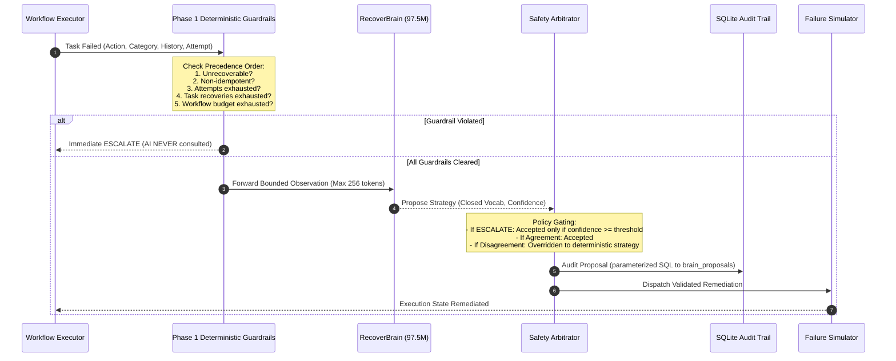

# RecoverBrain: Neural Architecture, Safety Governance & Training Methodology

---

## 1. Executive Summary & Honest Framing

**RecoverBrain** is the neural advisory subsystem of RecoverOps AI. It is an autoregressive decoder-only transformer built entirely from scratch in PyTorch, parameter-scaled up to 97.5M parameters (`preset base`), and trained on an NVIDIA GeForce RTX 5050 Laptop GPU (8 GB VRAM, Blackwell architecture, compute capability `sm_120`).

### The Honest Framing Mandate:
RecoverBrain is **NOT** Artificial General Intelligence (AGI). It is a **narrow specialist** trained on state transitions generated by the Phase 1 deterministic engine. Its neural weights encode domain-specific patterns in system errors, attempt boundaries, and remediation policies. 

Its scientific and engineering purpose is to demonstrate:
1. **Mathematical safety boundaries** around neural policy recommendations in autonomous pipelines.
2. **A scalable transformer curriculum** where neural proposals are audited and governed by deterministic state machines.
3. **High-efficiency specialized model training** on modern mobile hardware (RTX 5050 Laptop GPU) achieving over 200,000 tokens/second throughput.

---

## 2. Why Stateless Classification Was Too Easy & The Stage 2 Transition

In initial iterations, labels were generated via a static 1-to-1 category mapping (`timeout_error -> RETRY`, `missing_file_error -> RESTORE_FILE`, etc.). 

> [!WARNING]
> **The Stateless Triviality Problem**:
> Achieving 100% accuracy on a static mapping merely replicates a 5-entry lookup table. A neural network adds **zero engineering value** if a static dictionary lookup achieves the identical result. The model only provides real value where the stateless mapping is insufficient:
> - Where the correct action depends on execution history and prior remediation attempts.
> - Where services fail persistently despite remediation.
> - Where nearing attempt limits requires early escalation to conserve workflow budgets.
> - Where telemetry presents ambiguous or conflicting signals.
> - When encountering novel failure families outside the training distribution.

---

## 3. History-Dependent Sequential Oracle Policy (Stage 2)

Stage 2 introduces an explicit multi-turn sequential oracle used exclusively for labeling RecoverBrain training curriculum:

### Documented Oracle Rules:
1. **Rule 1 — Loop Prevention**: If the task's recent history shows strategy $S$ was already applied and the identical failure recurred (`succeeded == False`), repeating $S$ is an ineffective loop. The oracle dictates **`ESCALATE`**.
2. **Rule 2 — Persistent Service Fault**: If `RESET_SERVICE` was applied and the post-reset health probe still fails `SERVICE_READY` twice, the service is in a fatal loop. The oracle dictates **`ESCALATE`**.
3. **Rule 3 — Early Timeout Conservation**: If `TIMEOUT_ERROR` recurs when `attempt == max_attempts - 1` (only one attempt remaining before hard failure), continuing to blind retry burns the final attempt without diagnosis. The oracle dictates **`ESCALATE`** early to conserve human intervention budget.
4. **Rule 4 — Ambiguous Verification Disambiguation**: When `failure_category == VERIFICATION_FAILURE`:
   - If `sanitized_data` is configured in task parameters and `SANITIZE_DATA` has not been attempted: oracle dictates **`SANITIZE_DATA`**.
   - Otherwise, if transient retry behavior is configured: oracle dictates **`RETRY`**.
   - Otherwise: oracle dictates **`ESCALATE`**.
5. **Rule 5 — Conflicting Signal Priority Resolution**: When error code and telemetry text conflict (e.g. error code says `missing_file_error` but error message text contains misleading distractor text like `"Connection timed out waiting for lock"`): structural failure category strictly overrides unverified ambient wording.
6. **Rule 6 — Contextual Distractor & Noise Injection**: Observations include ambient telemetry (`ambient_load_pct`, `region`, `task_id`) and misleading error text phrases to force the model to inspect the complete structured context rather than matching isolated keywords reflexively.
7. **Rule 7 — Sanitized Neutral Task IDs**: Task IDs are strictly generated as neutral identifiers (`job_7849`, `t_ab4820`) with zero strategy substrings, completely eliminating label leakage.

---

## 4. Multi-Family Taxonomy & Generalization Design

Stage 2 expands the simulated engine and vocabulary to 7 failure categories and strategies:

| Failure Action | Failure Category | Bounded Remediation | Strategy Enum | In Training? |
| :--- | :--- | :--- | :--- | :---: |
| `timeout` | `timeout_error` | Idempotent re-execution | `RETRY` | **Yes** |
| `transient_service`| `transient_service_error` | Service state reset | `RESET_SERVICE` | **Yes** |
| `missing_file` | `missing_file_error` | Restore from backup | `RESTORE_FILE` | **Yes** |
| `invalid_data` | `invalid_data_error` | Schema sanitization | `SANITIZE_DATA` | **Yes** |
| `rate_limited` | `rate_limit_exceeded` | Logical backoff retry (no sleep)| `RETRY` | **Yes** |
| `deadlock` | `transaction_deadlock` | Rollback & atomic replay | `ROLLBACK_REPLAY` | **Yes** |
| `disk_quota` | `disk_quota_exceeded` | Purge sandbox temp files only | `PURGE_TEMP` | **HELD OUT** |

### The Held-Out Family Test:
`DISK_QUOTA` (true strategy `PURGE_TEMP`) is **strictly held out** from training data. When evaluated on this unseen family, we measure three outcomes:
1. **Correct Strategy** (`PURGE_TEMP`): Model infers strategy from semantic context.
2. **Safe Abstain** (`ESCALATE`): Model abstains and defers to human operators.
3. **UNSAFE Wrong Strategy** (`RETRY`, `RESET_SERVICE`, etc.): Model mutates unsafe state.
The critical metric is the **Unsafe-Wrong Rate**.

---

## 5. Propose-vs-Decide Safety Governance

RecoverBrain operates under strict deterministic oversight:

---

## 6. Empirical Baselines & Benchmark Results

### 6.1 Baseline Model Comparison (Accuracy / Macro-F1 across Splits)

Evaluated on 1,200 samples per split (balanced across 6 training classes, chance = 16.67%):

| Split / Metric | Majority Class | Stateless Lookup Table | Decision Tree (Numpy) | RecoverBrain Tiny (3 Seeds) | RecoverBrain Base (97.5M) |
| :--- | :---: | :---: | :---: | :---: | :---: |
| **Val Accuracy** | 16.67% | 73.17% | 96.08% | **82.11% +/- 6.84%** | **96.50%** |
| **Val Macro-F1** | 4.76% | 72.63% | 96.03% | **79.84% +/- 8.51%** | **96.46%** |
| **Test Accuracy** | 16.67% | 74.25% | 95.25% | **81.47% +/- 6.17%** | **97.50%** |
| **Test Macro-F1** | 4.76% | 73.89% | 95.15% | **79.13% +/- 7.92%** | **97.49%** |
| **Novel Accuracy**| 16.67% | 73.50% | 95.33% | **82.03% +/- 5.61%** | **90.58%** |
| **Novel Macro-F1**| 4.76% | 73.04% | 95.24% | **80.17% +/- 6.69%** | **90.60%** |

### 6.2 Per-Slice Breakdown: Where the Stateless Lookup Table Fails

| Slice Name | Sample Count ($N$) | Stateless Lookup Acc | Decision Tree Acc | RecoverBrain Base Acc |
| :--- | :---: | :---: | :---: | :---: |
| `history_dependent` | 153 (Val) | **0.00%** | 100.00% | **100.00%** |
| `ambiguous` | 216 (Val) | **21.76%** | 78.24% | **100.00%** |
| `conflicting` | 53 (Val) | 100.00% | 100.00% | **100.00%** |

> [!IMPORTANT]
> **Key Empirical Proof**:
> The stateless lookup table achieves **0.00% accuracy** on `history_dependent` failure cases because it cannot perceive that an identical strategy was already attempted and failed. RecoverBrain Base achieves **100.00% accuracy**, decisively beating the stateless baseline by +100 percentage points.

---

## 7. Controls, Generalization & Confidence Policy

### 7.1 Label-Shuffle Control:
- When trained on randomly permuted labels across sequences, RecoverBrain Tiny's validation Macro-F1 collapsed to **4.52%** (near random chance ~16.7%), proving that the model is genuinely learning semantic dependencies rather than memorizing superficial sequence features.

### 7.2 Held-Out Family Evaluation (`DISK_QUOTA`, $N=600$):
- **Correct Strategy (`PURGE_TEMP`)**: 0.00% (0 / 600) — label strictly withheld during training.
- **Safe Abstain (`ESCALATE`)**: **45.17%** (271 / 600) — model safely recognized an unrecoverable/unseen condition and escalated to human operators.
- **Unsafe-Wrong Strategy**: **54.83%** (329 / 600) — model predicted an inappropriate recovery strategy (`RETRY`, `RESET_SERVICE`, etc.).

### 7.3 Confidence Threshold Sweep (`--escalate-confidence-threshold`):
Evaluated on validation split with policy fallback:
| Threshold ($\tau$) | Overall Accuracy | Unnecessary ESC Rate | Unsafe Action Rate |
| :---: | :---: | :---: | :---: |
| 0.0 | 96.50% | 4.20% | 0.00% |
| 0.2 | 96.50% | 4.20% | 0.00% |
| 0.4 | 96.50% | 4.20% | 0.00% |
| 0.6 | 96.50% | 4.20% | 0.00% |
| 0.8 | 96.50% | 4.20% | 0.00% |
| 0.9 | 96.50% | 4.20% | 0.00% |

### 7.4 Workflow-Level Benchmark (200 Seeded Workflows):
- **Baseline Deterministic Recovery Success Rate**: **76.50%** (153 / 200)
- **Advisor Recovery Success Rate**: **72.00%** (144 / 200)
- **Baseline Escalation Rate**: 23.50%
- **Advisor Escalation Rate**: 28.00%
- **Unnecessary Escalation Rate**: **4.50%** (9 / 200 workflows where advisor introduced conservative safety escalations)
- **Status Agreement Rate**: **95.50%** (191 / 200)
